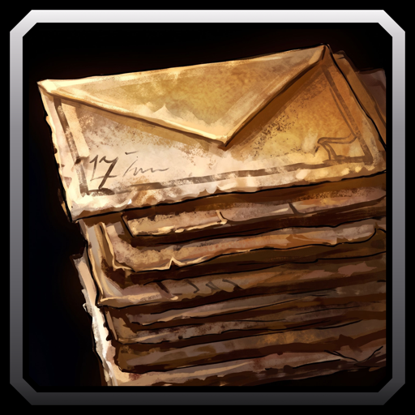

# Alt Mailing

Pick any of your alts from an arrow next to the mail To: box, with your favorite already filled in.

- **Lists** every alt that opened a mailbox
- **Fills in** your starred alt on the Send Mail tab and after each send
- **Adds and removes** names right in the list

## Why use it

- **Zero setup.** Each alt joins the list the first time it opens a mailbox.
- **Native look.** Blizzard's own arrow dropdown, star and remove buttons, nothing else on the mail window.
- **No typing.** Your favorite is in the To: box before you start.

## Features

- Alts in class colours, A to Z, with the one in To: ticked
- Click an alt's star to make it your favorite, click it again to clear it
- Hover an alt and click its X to take it off the list
- Type any name into To: and pick Add in the list to keep it
- Replies keep the sender's name

## Quick start

1. Open a mailbox once on each alt
2. On the Send Mail tab, click the arrow next to To: and pick an alt
3. Click an alt's star to have it filled in every time

## Commands

`/am`, `/am intro` and `/am help`

## Good to know

- Typing in To: keeps Blizzard's own suggestions, which already rank your alts above everyone else
- The character you are on never shows in its own list
- A removed alt comes back the next time it opens a mailbox
